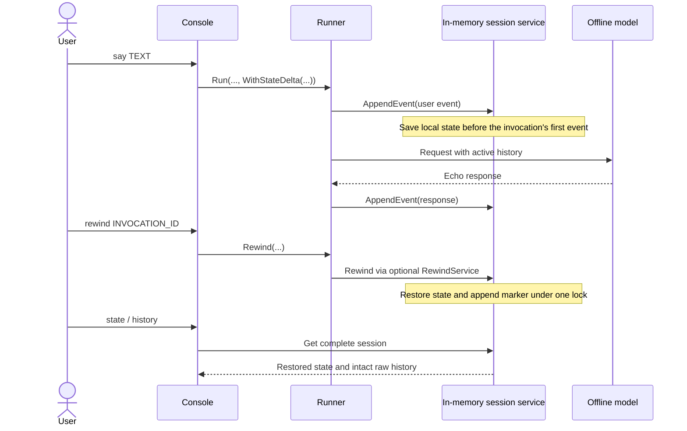

# Rewind a session and continue from an earlier turn

This framework prototype adds `Runner.Rewind` and native in-memory state
restoration. The console uses an offline echo model and prints the actual model
request, stored state, and raw event log so the result can be inspected directly.

- **Concept:** Rewind before an invocation without deleting its raw events.
- **Needs LLM?** No external model; an offline implementation of `model.LLM` is included.

## Goal

Verify that a new turn sees the restored conversation and state through the
ordinary runner and session APIs. The demonstration runs five turns and three
rewinds, including a rewind across an earlier rewind and a return to initial state.

## Requirements

Use the Go version in the repository's `go.mod`. No credentials or external
services are needed.

## How it works



`Runner.Rewind(ctx, userID, sessionID, beforeInvocationID)` restores the state
immediately before that invocation's first persisted event. `session.Service`
keeps its existing method set; the runner checks the optional
`session.RewindService` capability. In-memory storage implements it. The database
and Vertex AI services return `session.ErrRewindUnsupported`.

`session.ActiveEvents` applies the markers to the complete raw history. Prompt
assembly, routing, confirmation handling, workflow reconstruction, compaction,
and memory ingestion use that same filter. `Get` continues to expose
the raw log. REST output preserves the marker, but this prototype adds no REST
rewind endpoint or ADK Web rewind control.

## Running the sample

From the repository root:

```bash
go run ./examples/session_rewind -demo
```

For an interactive console:

```bash
go run ./examples/session_rewind
```

| Command | Meaning |
| --- | --- |
| `say TEXT` | Run a new turn and show the model request. |
| `set KEY JSON` | Stage a state delta for the next turn, e.g. `set city "Beijing"`. |
| `state` | Read the canonical stored state through `Service.Get`. |
| `history` | Show raw events and their active/rewound status. |
| `rewind ID` | Restore the session to before that invocation. |
| `rewind first` / `rewind last` | Select the first/last active user turn. |
| `help` / `quit` | Show help or leave the process. |

Successful rewind clears staged changes. Run `state` after rewinding to see
that introduced keys disappear and original values return.

## Example session

Actual output captured with `go run ./examples/session_rewind -demo`. The model
and generated IDs are deterministic in demo mode; no network requests run.

```text
Native session rewind prototype | in-memory service | offline echo model
Commands: say TEXT, set KEY JSON, state, history, rewind ID|first|last, help, quit

> state
Stored state:
{
  "city": "Shanghai",
  "language": "zh",
  "nullable": null
}

> set city "Hangzhou"
State change staged for the next turn.

> say Plan a trip.
Model context:
  user: Plan a trip.
Assistant: Acknowledged: Plan a trip.
Invocation: e-id-001

> set city "Beijing"
State change staged for the next turn.

> set booking true
State change staged for the next turn.

> say Pick a morning flight.
Model context:
  user: Plan a trip.
  model: Acknowledged: Plan a trip.
  user: Pick a morning flight.
Assistant: Acknowledged: Pick a morning flight.
Invocation: e-id-005

> state
Stored state:
{
  "answer": "Acknowledged: Pick a morning flight.",
  "booking": true,
  "city": "Beijing",
  "language": "zh",
  "nullable": null
}

> rewind last
Rewound before e-id-005. Stored state restored; pending changes cleared.

> state
Stored state:
{
  "answer": "Acknowledged: Plan a trip.",
  "city": "Hangzhou",
  "language": "zh",
  "nullable": null
}

> set city "Shenzhen"
State change staged for the next turn.

> say Pick an afternoon flight.
Model context:
  user: Plan a trip.
  model: Acknowledged: Plan a trip.
  user: Pick an afternoon flight.
Assistant: Acknowledged: Pick an afternoon flight.
Invocation: e-id-011

> rewind last
Rewound before e-id-011. Stored state restored; pending changes cleared.

> say Compare trains.
Model context:
  user: Plan a trip.
  model: Acknowledged: Plan a trip.
  user: Compare trains.
Assistant: Acknowledged: Compare trains.
Invocation: e-id-017

> rewind first
Rewound before e-id-001. Stored state restored; pending changes cleared.

> state
Stored state:
{
  "city": "Shanghai",
  "language": "zh",
  "nullable": null
}

> say Start again.
Model context:
  user: Start again.
Assistant: Acknowledged: Start again.
Invocation: e-id-023

> history
Raw events: 13 | Active events: 2
  id-002  rewound  invocation=e-id-001 author=user
  id-003  rewound  invocation=e-id-001 author=assistant
  id-006  rewound  invocation=e-id-005 author=user
  id-007  rewound  invocation=e-id-005 author=assistant
  id-010  marker   before=e-id-005
  id-012  rewound  invocation=e-id-011 author=user
  id-013  rewound  invocation=e-id-011 author=assistant
  id-016  marker   before=e-id-011
  id-018  rewound  invocation=e-id-017 author=user
  id-019  rewound  invocation=e-id-017 author=assistant
  id-022  marker   before=e-id-001
  id-024  active   invocation=e-id-023 author=user
  id-025  active   invocation=e-id-023 author=assistant
```

## Notes

- This is a framework prototype for [issue #1944](https://github.com/google/adk-go/issues/1944),
  with an API intended for discussion. Existing callers gain checkpoint overhead
  even if they never call rewind: one deep copy of local state per invocation,
  retained for each still-active invocation. This needs an opt-in or retention
  policy before production use with large sessions.
- Checkpoints are process-local. Restarting loses the session and checkpoints.
  Replaying raw events alone cannot recover initial state or these checkpoints.
- Only session-scoped state is restored. Current `app:` and `user:` state remains;
  `temp:` state is excluded. Restoring the whole local map removes keys introduced
  later while preserving keys explicitly set to `nil`. Setting a key to `nil`
  through an ordinary state delta still stores a present nil value.
- Checkpoints support scalar booleans, strings, integers and floats, plus nested
  `map[string]any`, `[]any` and `[]byte`. Other types, cycles and nesting beyond
  64 levels make that invocation unavailable for rewind; ordinary writes still
  work. Mutable state values must not be modified concurrently outside the
  session API.
- A rewind that would discard any artifact delta fails before changing state or
  history. Artifact restoration and recovery from partial artifact failures are
  intentionally unimplemented. External tool effects and previously stored
  memories are not rolled back.
- Finish the previous run, or cancel and drain it, before rewinding. Rewind does
  not cancel model calls or tools. Handles fetched before a successful rewind
  cannot append; obtain a fresh handle. Invocation IDs removed entirely from
  active history cannot be reused. The runner generates fresh IDs for new turns.
- A2A peers retain their own conversations. Local rewind can succeed, but a later
  remote call fails with `ErrRewindUnsupported` if it would reuse a task or context
  from before any rewind, even one discarding only local events. Starting a fresh
  remote context works; rewinding before the first remote interaction removes
  the local references. This prototype does not restore peer state.
- Pass complete history to `ActiveEvents`. Applying a recent-event or timestamp
  filter first may omit the target or marker. A custom session service must
  preserve the new field and implement atomic restoration and stale-write
  rejection to offer `RewindService`; accepting arbitrary marker events through
  `AppendEvent` is insufficient.

### Python design reference

Checked at adk-python commit
[`ab638443816b425787dbb6b2fd835cdf03bbcbef`](https://github.com/google/adk-python/tree/ab638443816b425787dbb6b2fd835cdf03bbcbef):

- [`Runner.rewind_async`](https://github.com/google/adk-python/blob/ab638443816b425787dbb6b2fd835cdf03bbcbef/src/google/adk/runners.py#L1395)
  reads the session and delegates restoration.
- [`_rewind_events.py`](https://github.com/google/adk-python/blob/ab638443816b425787dbb6b2fd835cdf03bbcbef/src/google/adk/events/_rewind_events.py#L27)
  filters history using rewind markers. This prototype follows that approach.
- [`_rewind_utils.py`](https://github.com/google/adk-python/blob/ab638443816b425787dbb6b2fd835cdf03bbcbef/src/google/adk/sessions/_rewind_utils.py#L53)
  reconstructs state from event deltas and uses `None` for removed keys. This
  prototype deliberately uses checkpoints and replaces local state, preserving
  initial values and distinguishing missing keys from explicit nil values. Python
  preserves untouched initial keys, but cannot recover initial values overwritten
  by discarded events. Its marker carries restoring state/artifact deltas; this
  prototype keeps restoration in private checkpoints, so its event log alone
  is insufficient to replay state.
- [Artifact restoration](https://github.com/google/adk-python/blob/ab638443816b425787dbb6b2fd835cdf03bbcbef/src/google/adk/sessions/_rewind_utils.py#L103)
  saves historical content as a new version or writes a tombstone. The prototype
  rejects this operation pending an agreed failure and recovery design.

Unlike Python, this prototype rejects reuse of fully discarded invocation IDs
to prevent a later rewind from targeting an earlier incarnation of that ID.
